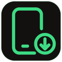
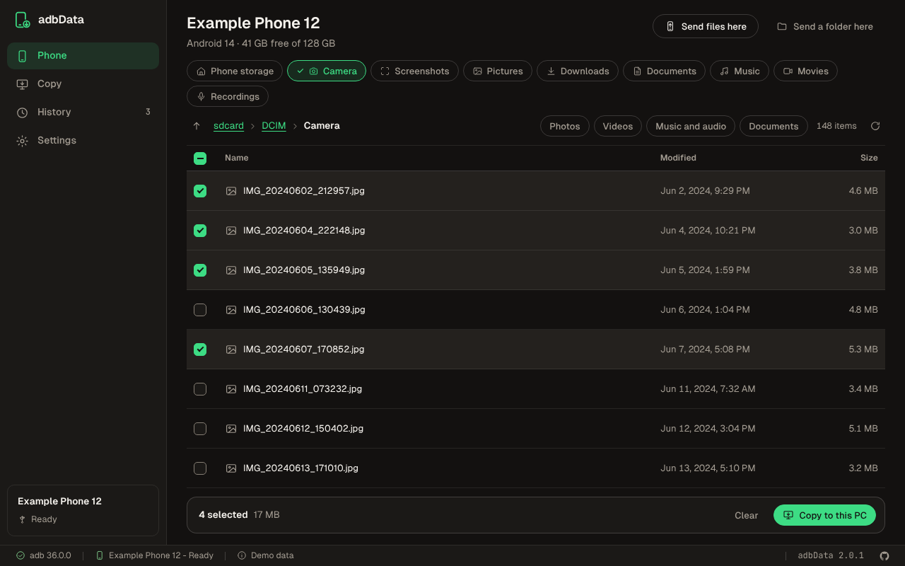
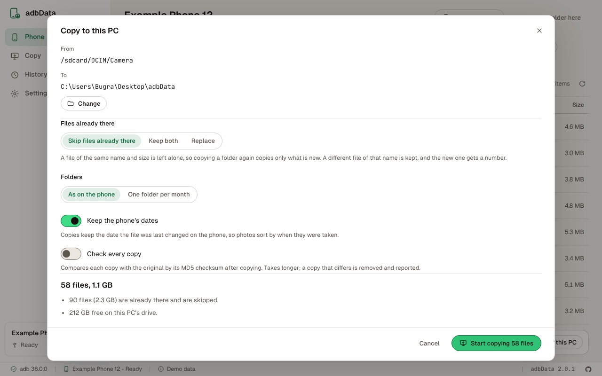
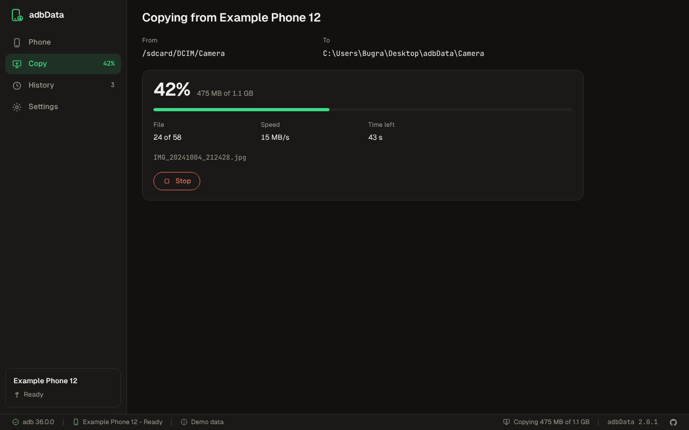
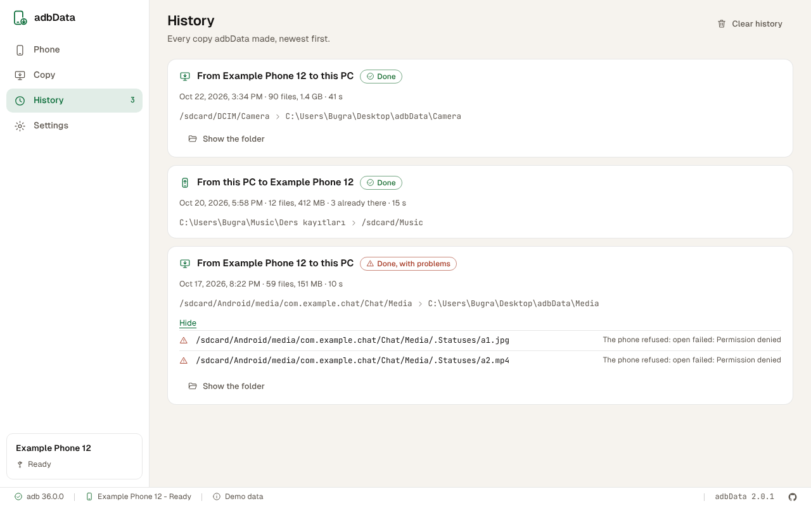

# adbData



Copy photos, videos and files between an Android phone and a Windows PC, fast.

adbData is a Windows app that copies files over adb instead of Windows' own phone connection
(MTP): faster, without the connection dropping half way, and keeping each file's date. Browse the
phone, pick files or whole folders, see what will happen, and copy. Copying a folder again copies
only what is new. The phone needs no app and no root.

<br clear="left">

> **Not fully tested yet.** Version 2.0.1 is tested against a simulated adb server that behaves
> like a phone (including a cable pulled out half way), and on GitHub's Windows runners it
> downloads Google's real adb and talks to its server. It has not been used with a real phone yet.



## What it does

- **Copies fast.** adbData talks to adb's server directly, the way adb itself does, and copies a
  whole folder over one connection. The old script started two programs for every file, and more
  to check sizes and checksums; with thousands of photos that was most of the time.
- **Browses the phone.** Camera, Screenshots, Pictures, Downloads, Documents, Music, Movies and
  Recordings are one click away; filter by photos, videos, audio or documents. Hidden files (the
  phone's trash, thumbnails) stay out unless you want them.
- **Shows what will happen first.** Before anything is copied: how many files, how much, which
  are already on the PC, which names Windows does not allow, and whether there is room.
- **Copies again without copying twice.** A file already on the PC with the same name and size is
  skipped, so an interrupted copy, or next month's photos, picks up where it stopped. You can also
  keep both or replace.
- **Keeps dates and names.** Copies keep the phone's modification time, so photos sort by when
  they were taken. Turkish and other non-English names work; names Windows refuses (`12:30`,
  `what?`) are copied with `_` in place of those characters.
- **Never leaves half a file.** Each file is written under a temporary name and renamed when it is
  complete. If the cable comes out, adbData reconnects and tries that file again; if the phone is
  gone, it stops and says which files were not copied.
- **Checks copies if you ask.** Compares each copy's MD5 with the phone's, in batches, and removes a
  copy that differs so copying again fixes it.
- **Sends files to the phone too**, into the folder you are looking at.
- **Keeps a history** of every copy, with what failed and why.
- English and Turkish, light and dark theme, on the Bugra design system.



## Download

From [Releases](https://github.com/bugragungoz/adbData/releases): the `.exe` installer (for your
account) or the `.msi` (for every account). Windows 10 and 11, 64-bit.

## Use

1. On the phone: Settings > About phone, tap Build number seven times, then turn on USB debugging in
   Developer options.
2. Connect it with a cable that carries data. Unlock the phone and allow USB debugging for this
   computer (tick Always allow).
3. No adb on the computer? adbData offers to download Google's platform-tools (about 7 MB) into its
   own folder.
4. Pick files or folders and choose **Copy to this PC**, or **Copy everything shown**. Check the
   review and start.

The phone does not need to be in file transfer (MTP) mode; charging only is fine. A USB 3 port and
cable can copy faster, when the phone supports USB 3.



## Where things are kept

| What | Where |
|---|---|
| Copies from the phone | `Desktop\adbData` unless you choose another folder in Settings or before a copy |
| Settings | `%APPDATA%\com.bugragungoz.adbdata\settings.json` |
| History | `%LOCALAPPDATA%\com.bugragungoz.adbdata\history.json` (the last 300 copies) |
| Downloaded platform-tools | `%LOCALAPPDATA%\com.bugragungoz.adbdata\platform-tools\` |



## From the script

Version 1 was a PowerShell script with a menu. Besides being slow with many files, it had bugs that
version 2 does not have:

- Paths containing `&`, `;`, `|`, `$`, `<`, `>`, `\` or a backtick were refused as "dangerous",
  so a file like `Tom & Jerry.mp4` could not be copied at all. adbData sends paths to the phone as
  data, and quotes them where it uses the phone's shell (for the checksum check), so every name
  works.
- Copies got the date they were copied, not the phone's.
- Listing a folder ran `stat` once for every file on the phone.
- "Parallel" mode copied in batches, one file at a time.
- The repository carried Google's platform-tools and a phone maker's USB driver installer. adbData
  downloads platform-tools from Google when needed; USB drivers come from Windows Update or the
  phone's maker.

The script is in the history of this repository.

## Build it yourself

```bash
npm ci                    # the interface's packages
npm run dev               # the app, with the window reloading as you edit
npm run verify            # versions, translations, lint, colors, types and the interface's unit tests
cargo test --workspace    # the Rust core (against a simulated adb server) and the app's shell
npm run test:ui           # the built interface in Chromium against a simulated phone
npm run shots             # the screenshots above
npm run icons             # the Windows icons from docs/design/icon.svg
npm run build             # the installers (on Windows)
```

`cargo test -p adbdata-core --test network -- --include-ignored` downloads Google's platform-tools
and checks adbData's protocol code against the real adb server.

`npm run dev:web` runs the interface alone in a browser, against the simulated phone of
`src/api/mock.ts`.

## License

[MIT](LICENSE)

The first version was developed with assistance from an AI model: Claude Sonnet 4.5.

It was later rebuilt with Claude Opus 5.5.
